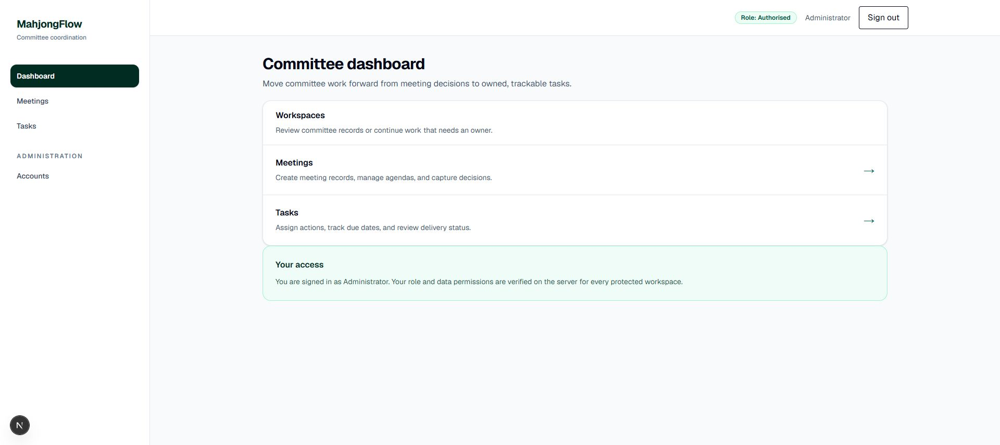
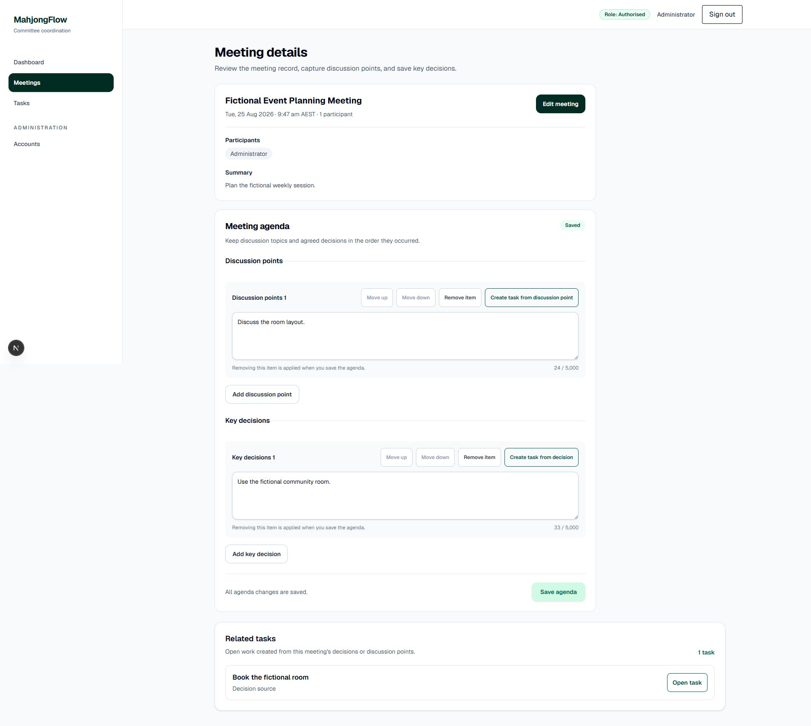
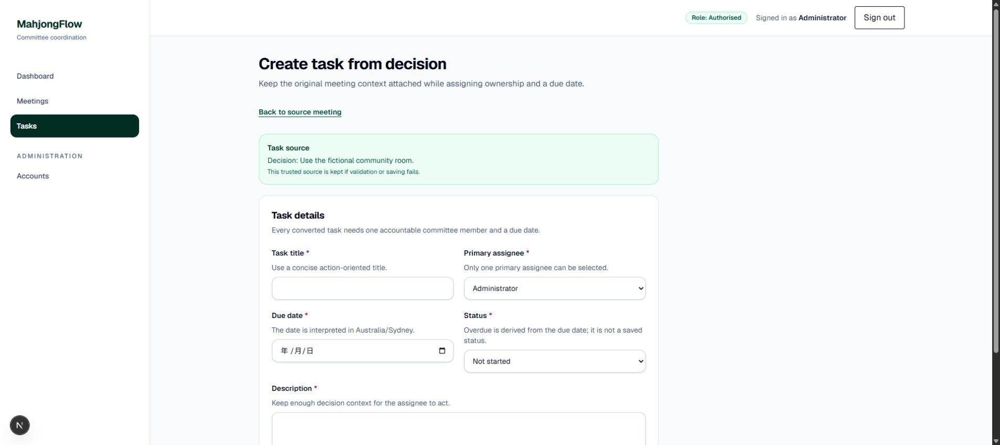
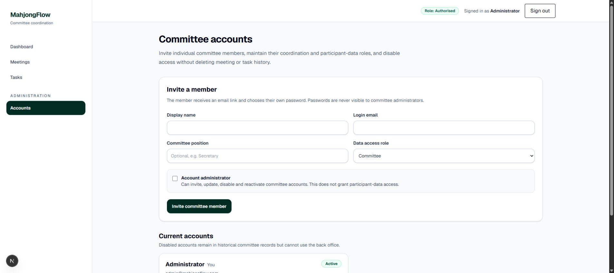
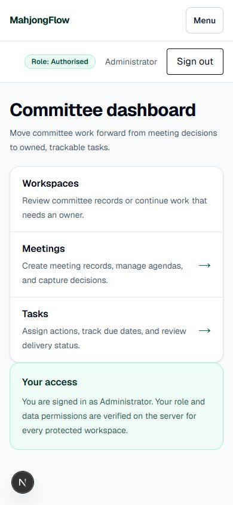
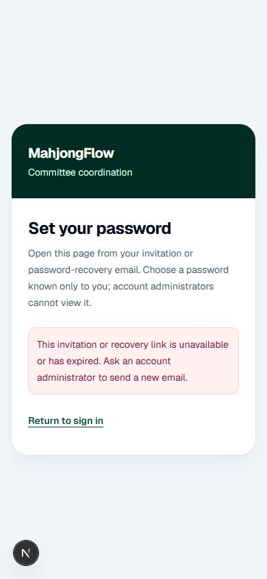

# MahjongFlow 全站 UI/UX 审计与优化记录

审计日期：2026-08-27
审计模式：UX 与可访问性联合审计
视觉复验环境：Google Chrome；桌面视口与 390 × 844 移动视口
数据要求：仅使用仓库内虚构演示数据

## 1. 审计范围

本轮覆盖以下页面与主要状态：

- 登录与密码设置；
- 委员会仪表盘；
- 会议列表、会议详情、会议创建、议程编辑、删除入口；
- 任务列表、任务详情、任务创建、任务编辑、决策转任务；
- 账户邀请、账户编辑、停用／恢复与密码恢复入口；
- 报名模块的授权检查、加载、空状态与错误恢复；
- 桌面导航、移动导航、焦点入口、目标尺寸、响应式回流和横向溢出。

核心用户目标是：委员会成员能够从会议记录与决策出发，快速创建并跟踪有负责人和截止日期的任务，同时清楚理解自己的访问范围。

## 2. 已确认的优势

- 颜色、圆角、边框、阴影和字体层级形成一致的 emerald／slate 视觉系统。
- 会议与任务主流程的页面标题、说明、表单分组和操作按钮层级清晰。
- 会议来源与任务来源保持可追溯，决策转任务页面保留可信来源上下文。
- 危险操作使用独立的确认界面；加载、空状态、权限拒绝和系统错误均有专用反馈。
- 受保护页面在服务端完成角色与权限校验，视觉层没有把导航可见性当作授权边界。
- 抽查页面在桌面和 390px 移动视口下均未出现横向溢出。
- 键盘第一次 Tab 会进入“跳到主要内容”，主内容和导航语义结构有效。

## 3. 本轮发现并已解决的问题

### P1：仪表盘信息过时且无法支撑当前主流程

原页面仍描述 Sprint 2 基础演示和“后续将添加会议、任务”等已过时信息。本轮改为面向当前产品的委员会仪表盘，提供会议与任务两个主工作区入口，并显示当前用户及服务端权限说明。

### P1：密码设置页出现重复页面层级

原页面在 `LoginShell` 的“Sign in”标题内再次嵌套“Set your password”卡片，形成两个一级标题和双层卡片。本轮改为复用壳层标题与说明，只保留一个一级标题；失效链接状态新增“Return to sign in”恢复路径。

### P1：主导航暴露尚未可用的报名模块

`/registrations` 仍是受保护的直接访问占位页，但主导航不再展示无可执行工作流的入口，避免用户进入死胡同。后续报名工作流达到可用验收后再恢复入口。

### P2：关键交互目标偏小

桌面和移动导航、退出按钮、任务返回链接、会议议程控制、会议打开／删除入口、来源返回入口、账户操作按钮已统一到至少 44px 高的交互目标。原生复选框仍保持平台尺寸，但位于可点击标签容器内。

### P2：账户管理表单错误与焦点状态不完整

邀请与编辑表单的字段错误现已通过 `aria-describedby` 与对应输入关联；编辑字段补齐可见焦点环；账户详情摘要与操作按钮也补齐最小交互高度。

### P2：账户页标题样式不一致

移除页面内重复的全大写“Administration”眉题，保留导航分组标签和明确的页面一级标题，减少层级噪音。

### P2：颜色组合的机械质量提示

根据 UI 检测结果，调整有色背景上的灰色正文和部分悬停色组合。最终机械检测结果为零项。

## 4. 视觉证据

以下为优化后的代表性页面；完整截图位于 `docs/audits/assets/ui-ux-2026-08-27/`。

### 桌面端仪表盘

### 会议详情与议程

### 决策转任务

### 账户管理

### 移动端仪表盘

### 移动端密码链接失效恢复

## 5. 验证结果

- ESLint：通过；
- TypeScript 与 Next.js 路由类型：通过；
- Vitest 与脚本测试：60 个测试文件、329 项测试全部通过；
- Next.js 生产构建：通过；
- UI 机械反模式检测：零项；
- Chrome 新会话控制台：抽查路由无 error／warning；
- 页面结构：抽查的稳定页面均只有一个一级标题；
- 响应式：抽查的桌面和 390px 页面均无横向溢出；
- 键盘入口：首次 Tab 聚焦“Skip to main content”。

## 6. 仍需保留的限制与后续事项

- 报名模块尚未实现业务工作流，因此只保留直接 URL 下的授权占位、加载和错误状态；本轮没有虚构报名功能。
- 本轮验证可以确认已检查页面的结构、键盘入口、目标尺寸和响应式表现，但不声明完整 WCAG 合规。完整结论仍需要屏幕阅读器矩阵、200%／400% 缩放和人工对比度复核。
- Chrome 使用现有已登录的 authorised 测试会话完成受保护流程复验；登录表单本身使用未登录浏览器状态完成了视觉检查，但没有提交凭据。
- 浏览器复验未执行会写入数据的最终提交操作，因此没有创建、修改或删除会议、任务、账户或报名记录。

## 7. 结论

优化后，全站主要 UI/UX 已符合当前 MVP 的信息架构与核心工作流：入口更聚焦，标题层级更准确，移动端无溢出，交互目标和表单可访问性更稳健。当前剩余项主要是尚未进入实现范围的报名业务，以及需要专门辅助技术环境才能完成的深度无障碍认证。
