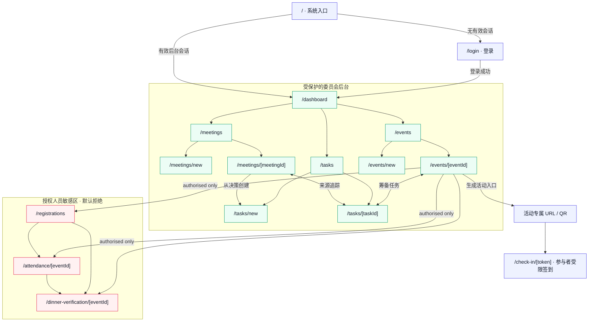

# 第 2 天步骤 5：P0 页面清单与信息架构

## 1. 执行结论

第 2 天步骤 5 已完成。已依据 P0 范围、验收矩阵、仓库路由基线和步骤 3–4 Backlog，定义 16 个页面入口，覆盖公共／系统入口、委员会后台、授权人员敏感操作和活动 token 签到四类访问区域。

本信息架构不增加公开自助报名、角色管理、复杂审计、通知中心或其他 P1/Post-MVP 页面。P0 报名由授权人员在后台完成；参与者在 P0 中只通过活动 token 进入受限签到页面。

## 2. 角色与访问标记

| 标记 | 角色／边界 | 页面访问原则 |
|---|---|---|
| `PUBLIC` | 未登录用户 | 只允许进入系统入口和登录页，不返回内部数据 |
| `TOKEN` | 持有效活动 token 的参与者 | 只允许当前活动的最小签到操作，不进入后台导航 |
| `COMMITTEE` | 普通委员会成员 | 可使用会议、任务、活动和非敏感汇总页面 |
| `AUTHORISED` | 秘书／授权人员 | 继承委员会权限，并可使用报名、签到明细和晚餐核验页面 |
| `SENSITIVE` | 敏感页面或敏感页面区块 | 路由、服务端和 RLS 均需验证授权角色；默认拒绝 |

隐藏导航项不构成权限控制。所有后台页面先验证有效会话；`SENSITIVE` 页面和操作还必须验证 `authorised` 角色及当前活动资源范围。

## 3. 页面清单

### 3.1 公共、认证与参与者受限页面

| ID | 路由 | 用途 | 主要角色 | 入口 | 可执行操作 | 对应 P0／Issue |
|---|---|---|---|---|---|---|
| PG-01 | `/` | 判断会话并把用户送往正确入口 | `PUBLIC`、已登录后台用户 | 直接访问站点 | 进入 `/login` 或 `/dashboard`；不展示业务数据 | AUTH-01、02／#9 |
| PG-02 | `/login` | 委员会后台登录 | `PUBLIC` | PG-01、受保护路由重定向 | 提交凭据、查看非枚举错误；已登录时返回 Dashboard | AUTH-01、02、05／#9、#11 |
| PG-03 | `/check-in/[token]` | 展示当前活动最小信息并提交本人签到 | `TOKEN` | 活动专属 URL／QR | 输入或确认最小身份信息、提交签到、查看本人成功／重复／过期／无效结果 | CHECKIN-01–04、PRIV-01–03／#30、#31 |

PG-03 不显示报名名单、签到名单、晚餐资格、其他参与者是否存在或内部活动操作。无效、过期或跨活动 token 使用同一类安全失败反馈。

### 3.2 委员会后台页面

| ID | 路由 | 用途 | 主要角色 | 入口 | 可执行操作 | 对应 P0／Issue |
|---|---|---|---|---|---|---|
| PG-04 | `/dashboard` | 汇总本人任务、全部待办、临期／逾期和近期活动 | `COMMITTEE`、`AUTHORISED` | 登录成功、全局导航 | 打开任务、活动；查看站内到期提醒和非敏感汇总 | TASK-03、05、06，EVENT-05／#16、#19、#21、#22 |
| PG-05 | `/meetings` | 浏览历史会议 | `COMMITTEE`、`AUTHORISED` | 全局导航 | 查看列表、打开会议、进入新建页面 | MEET-04、05／#14 |
| PG-06 | `/meetings/new` | 新建会议记录 | `COMMITTEE`、`AUTHORISED` | PG-05 主要操作 | 填写基础字段、讨论点和关键决策并保存 | MEET-01–03／#12、#13 |
| PG-07 | `/meetings/[meetingId]` | 查看和更新会议，追踪决策产生的任务 | `COMMITTEE`、`AUTHORISED` | PG-05、任务来源链接 | 编辑会议；维护讨论点／决策；从来源创建任务；打开关联任务 | MEET-01–05，CONV-01、02、04／#12–#14、#23、#25 |
| PG-08 | `/tasks` | 查看和筛选本人及委员会任务 | `COMMITTEE`、`AUTHORISED` | 全局导航、Dashboard | 按负责人、状态、截止日期和活动筛选；打开或新建任务 | TASK-01、03、04／#15、#16、#20 |
| PG-09 | `/tasks/new` | 创建独立任务或来源任务 | `COMMITTEE`、`AUTHORISED` | PG-08；PG-07 携带来源参数 | 填写标题、描述、单一负责人、截止日期、状态和可选活动；保留只读来源 | TASK-01、02，CONV-01–03、05／#15、#23、#24 |
| PG-10 | `/tasks/[taskId]` | 查看和更新任务并返回来源会议 | `COMMITTEE`、`AUTHORISED` | PG-04、PG-08、PG-07、活动详情 | 更新字段和状态；查看到期状态、关联活动和来源；返回来源会议 | TASK-01–04，CONV-03–05／#15、#16、#20、#24、#25 |
| PG-11 | `/events` | 浏览即将到来和历史活动 | `COMMITTEE`、`AUTHORISED` | 全局导航、Dashboard | 查看活动列表、打开活动、进入新建页面 | EVENT-01、05／#17、#19 |
| PG-12 | `/events/new` | 新建周常活动或比赛 | `COMMITTEE`、`AUTHORISED` | PG-11 主要操作 | 填写类型、名称、日期时间、地点、描述和状态 | EVENT-01、02／#17 |
| PG-13 | `/events/[eventId]` | 查看和更新活动、筹备任务与非敏感进度 | `COMMITTEE`、`AUTHORISED` | PG-04、PG-11、任务关联 | 编辑活动；打开关联任务；查看完成比例和报名／签到聚合数字；授权人员进入敏感操作 | EVENT-01–05、TASK-04、REG-07、CHECKIN-01、07／#17–#20、#28、#30、#34 |

PG-13 对普通委员会成员只返回聚合报名数和签到数，不查询或传输参与者姓名、邮箱、学号、签到明细或晚餐资格。签到 QR／URL 及敏感操作入口仅在授权人员区块中提供。

### 3.3 授权人员敏感页面

| ID | 路由 | 用途 | 主要角色 | 入口 | 可执行操作 | 对应 P0／Issue |
|---|---|---|---|---|---|---|
| PG-14 | `/registrations` | 按活动管理最小参与者资料和报名状态，并作为敏感活动操作入口 | `AUTHORISED`、`SENSITIVE` | 授权导航；PG-13 | 选择活动；新增／匹配参与者；创建、取消或恢复报名；查看报名与签到分离状态；进入签到明细或晚餐核验 | REG-01–07、PRIV-01、02／#26–#28 |
| PG-15 | `/attendance/[eventId]` | 查看活动签到明细并处理现场异常 | `AUTHORISED`、`SENSITIVE` | PG-13、PG-14 | 查看明细；人工补签；更正签到；查看方式、记录人和更新时间 | CHECKIN-05–07／#32–#34 |
| PG-16 | `/dinner-verification/[eventId]` | 根据当前确认签到核验晚餐资格 | `AUTHORISED`、`SENSITIVE` | PG-13、PG-14、PG-15 | 查找参与者；查看 `Eligible`／`Not Eligible Yet`；更正后刷新推导结果 | DINNER-01–04／#35–#37 |

> 页面编号共 16 个，其中 PG-01–PG-03 为公共／受限入口，PG-04–PG-13 为共享后台页面，PG-14–PG-16 为授权敏感页面。页面数量按可访问路由计算；loading、error、not-found 和表单成功反馈作为对应路由状态，不单独扩展业务页面。

## 4. 全局导航与模块层级

### 4.1 后台全局导航

所有已登录后台用户可见的一级导航保持为：

1. Dashboard；
2. Meetings；
3. Tasks；
4. Events。

授权人员额外看到 `Sensitive operations` 分组，其固定入口为 `Registrations`。签到明细和晚餐核验必须先选定活动，因此从活动详情或报名页进入，不增加无上下文的全局入口。

后台全局栏同时提供当前角色提示和 Sign out。MVP 不提供角色编辑、通知中心、设置中心或个人资料管理页面。

### 4.2 模块内层级

```text
Dashboard
├── 本人任务／全部待办／临期／逾期 → Task detail
└── 近期活动 → Event detail

Meetings
├── Meeting list
├── New meeting
└── Meeting detail
    ├── Discussion points / decisions
    ├── Create sourced task → New task
    └── Related tasks → Task detail

Tasks
├── Task list + filters
├── New task
└── Task detail
    ├── Source meeting → Meeting detail
    └── Related event → Event detail

Events
├── Event list
├── New event
└── Event detail
    ├── Preparation tasks → Task detail
    ├── Aggregate registration / attendance counts
    └── Authorised-only actions
        ├── Registrations
        ├── Attendance detail / correction
        ├── Dinner verification
        └── Activity check-in URL / QR → Token check-in page
```

## 5. 信息架构图



## 6. P0 操作承载检查

| P0 范围 | 页面承载 | 结论 |
|---|---|---|
| AUTH-01–05 | PG-01、PG-02、全部后台路由状态 | 已覆盖登录、登出、会话、保护与反馈 |
| MEET-01–05 | PG-05–PG-07 | 已覆盖创建、查看、更新、讨论点、决策和历史 |
| CONV-01–05 | PG-07、PG-09、PG-10 | 已覆盖来源创建、字段校验和双向导航 |
| TASK-01–06 | PG-04、PG-08–PG-10 | 已覆盖任务维护、筛选、到期计算、Dashboard 和站内提醒 |
| EVENT-01–05 | PG-04、PG-11–PG-13 | 已覆盖活动维护、筹备任务、进度和近期活动 |
| REG-01–07 | PG-13、PG-14 | 已覆盖最小资料、报名状态、唯一性及报名／签到分离 |
| CHECKIN-01–07 | PG-03、PG-13、PG-15 | 已覆盖 token/QR、窗口校验、自助签到、明细和人工更正 |
| DINNER-01–04 | PG-15、PG-16 | 已覆盖签到推导、授权核验和更正后重算 |
| PRIV-01–04 | PG-03、PG-13–PG-16；维护流程无用户页面 | 已覆盖最小展示和角色隔离；测试数据清理保持受控维护操作 |

## 7. 路由保护与反馈规则

| 场景 | 页面行为 | 安全要求 |
|---|---|---|
| 未登录访问后台 | 重定向至 `/login`，登录后返回安全目标 | 重定向目标只允许站内受保护路径，避免开放跳转 |
| 普通委员会访问敏感路由 | 显示统一权限拒绝状态或安全重定向 | 服务端不得查询或序列化敏感行；RLS 再次拒绝 |
| 授权人员访问其他活动资源 | 显示安全的不存在／无权限结果 | 同时验证角色和 `eventId` 资源范围 |
| 无效、过期或跨活动 token | PG-03 显示不可用及联系现场人员提示 | 不透露参与者、报名或活动内部状态 |
| 重复签到 | 显示已处理的幂等结果，不建立第二条记录 | 依赖服务端校验和数据库唯一约束 |
| 页面加载、空数据或系统失败 | 在原路由显示 loading、empty 或可恢复错误 | 错误信息不得包含密钥、SQL、内部 ID 或个人资料 |

## 8. 第 3 天需要确认的数据与权限输入

以下问题不阻塞本信息架构，但必须在第 3 天形成可实施规则：

1. PG-03 用于匹配已有参与者的最小输入，以及不泄露账号／参与者存在性的错误合同；
2. 活动 token 的存储形式、失效方式、有效窗口和跨活动拒绝规则；
3. PG-13 提供给普通委员会的报名／签到聚合查询字段，确保响应中不存在个人资料；
4. PG-14–PG-16 的授权角色、资源范围和直接数据库查询 RLS 规则；
5. 人工补签／更正的 `recorded_by`、更新时间和恢复边界；
6. 活动详情中签到 QR／URL 的创建、查看和撤销权限；
7. PG-03、PG-14–PG-16 各字段的敏感级别、必填性和保留原则。

## 9. 验收结果

- [x] 公共、委员会后台、授权敏感和 token 受限页面均已分类；
- [x] 每个页面均记录用途、主要角色、入口和可执行操作；
- [x] 全局导航和各业务模块层级已经确定；
- [x] 所有后台页面均标记为受保护路由；
- [x] 报名、签到明细和晚餐核验均标记为授权人员敏感页面；
- [x] 参与者仅通过活动 token 进入最小签到页面；
- [x] 每项 P0 操作均有页面或受控维护流程承载；
- [x] 没有新增 P1 或 Post-MVP 页面。
