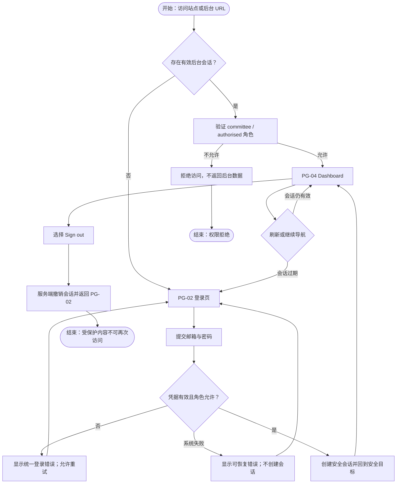
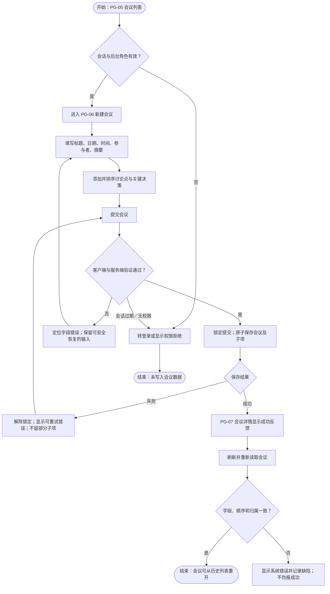
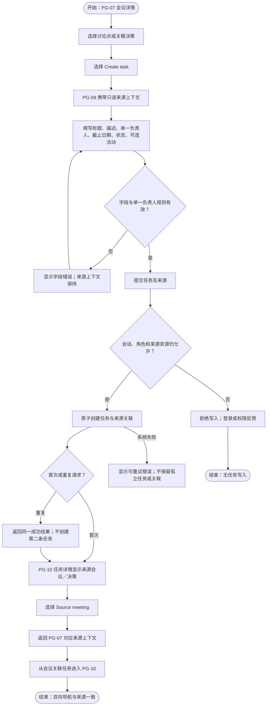
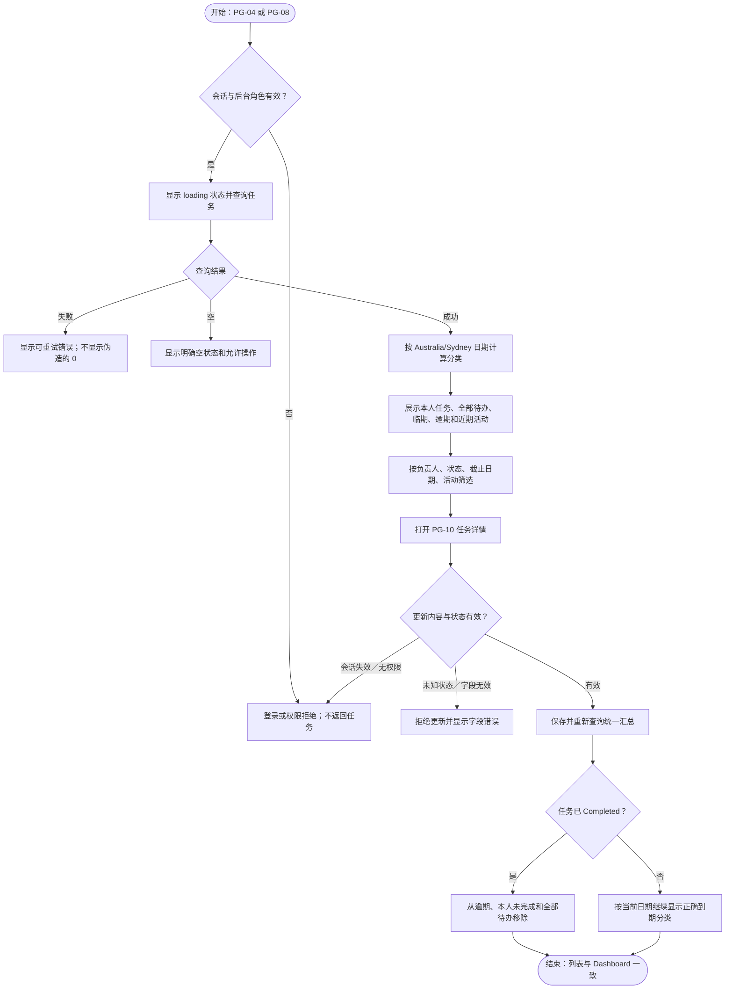
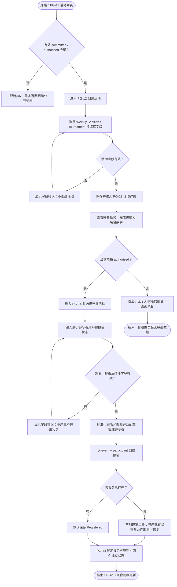
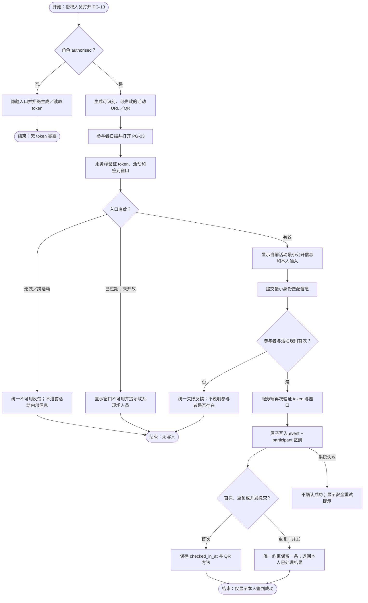
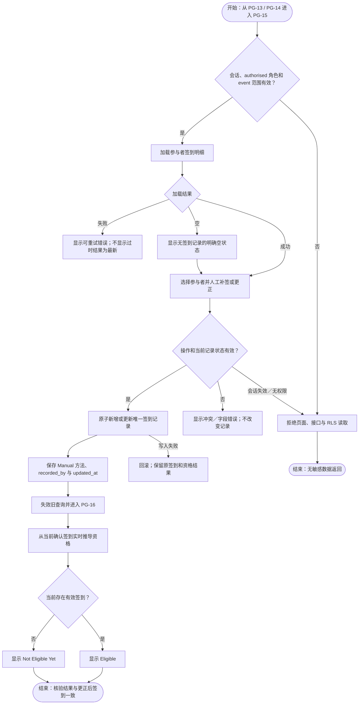

# 第 2 天步骤 6：P0 核心用户流程

## 1. 执行结论

第 2 天步骤 6 已完成。已基于
[步骤 5 页面清单与信息架构](DAY_2_STEP_5_PAGE_INVENTORY_AND_INFORMATION_ARCHITECTURE.md)，
绘制 7 条 P0 核心用户流程，覆盖登录、会议记录、决策转任务、任务跟进、
活动与报名、QR 签到、人工更正与晚餐核验。

每条流程均明确角色、起点、页面、关键操作、系统反馈和结束状态，并覆盖
适用的验证失败、系统失败、重复提交、会话失效、无权限、无效 token、
过期窗口和跨活动请求。流程只描述已批准的 P0，不增加公开自助报名、
外部通知、角色管理或独立晚餐资格编辑。

## 2. 流程索引

| Flow | 核心目标 | 主要角色 | 页面路径 |
|---|---|---|---|
| FL-01 | 登录并进入后台 | 委员会／授权人员 | PG-01 → PG-02 → PG-04 |
| FL-02 | 创建会议并记录决策 | 委员会／授权人员 | PG-05 → PG-06 → PG-07 |
| FL-03 | 从会议来源创建任务 | 委员会／授权人员 | PG-07 → PG-09 → PG-10 |
| FL-04 | 跟进本人及到期任务 | 委员会／授权人员 | PG-04／PG-08 → PG-10 |
| FL-05 | 创建活动并登记报名 | 委员会／授权人员 | PG-11 → PG-13／PG-14 |
| FL-06 | 通过活动 QR 签到 | 授权人员、参与者 | PG-13 → PG-03／PG-15 |
| FL-07 | 更正签到并核验资格 | 授权人员 | PG-15 → PG-16 |

验收场景和实施 Issue 集中列在“页面—流程—Backlog 追踪”一节，避免在
索引中重复堆叠信息。

## 3. FL-01：登录和进入后台

- **角色：** 委员会成员或秘书／授权人员。
- **起点：** 直接访问 PG-01，或访问任一受保护后台 URL。
- **成功结束：** 进入 PG-04；刷新后会话保持。
- **失败结束：** 停留 PG-02 并获得可恢复且不枚举账号的错误；无后台数据返回。

流程要求：

- 登录提交期间禁用重复提交；重复响应不得创建多个会话状态；
- 登录错误不得区分“账号不存在”和“密码错误”；
- 回跳目标只接受站内受保护路径，避免开放重定向；
- 活动参与者即使持有签到 token，也不能用该 token 进入后台。

## 4. FL-02：创建会议、讨论点和关键决策

- **角色：** 委员会成员或授权人员。
- **起点：** PG-05 会议列表。
- **成功结束：** PG-07 显示持久化后的会议、讨论点和决策。
- **失败结束：** 表单保留安全输入并显示字段或系统错误，不产生不完整记录。

流程要求：

- 传输中的重复点击由提交锁阻止；服务端失败不得留下只有会议主记录、没有子项的半成品；
- MVP 不提供永久删除。若后续提供归档，只能进入可追溯的非破坏性路径；
- 未登录或 token 参与者直接访问会议页面、接口或数据库时全部拒绝。

## 5. FL-03：从会议决策创建任务并返回来源

- **角色：** 委员会成员或授权人员。
- **起点：** PG-07 的讨论点或关键决策。
- **成功结束：** PG-10 显示来源，且 PG-07 显示关联任务。
- **失败结束：** 保持来源上下文并显示字段／权限／系统错误，不创建无来源或重复任务。

流程要求：

- 来源会议与来源决策／讨论点由入口带入并只读展示，不允许在普通任务字段中伪造；
- 同一次转换的重试必须幂等。第 3 天需确定提交幂等键或等效约束；
- 缺少负责人、截止日期或尝试多个主要负责人时拒绝提交；
- 来源不存在、已不可访问或会话过期时使用安全错误，不泄露其他会议内容。

## 6. FL-04：查看本人、临期和逾期任务

- **角色：** 委员会成员或授权人员。
- **起点：** PG-04 Dashboard 或 PG-08 任务列表。
- **成功结束：** 筛选结果、详情状态和 Dashboard 汇总使用同一口径。
- **失败结束：** 显示 loading、empty、权限拒绝或可恢复错误，不显示错误统计。

流程要求：

- 昨天到期且未完成为逾期；今天至未来 7 天为临期；未来第 8 天不属于临期；
- 提醒仅为站内视觉状态，不触发邮件、短信或推送；
- 筛选请求被重复触发时，以最新条件的结果为准，旧响应不得覆盖新结果；
- token 参与者和未登录用户不能访问任务、Dashboard、接口或数据库行。

## 7. FL-05：创建活动、登记参与者和报名

- **角色：** 委员会成员创建活动；仅授权人员登记参与者和报名。
- **起点：** PG-11 活动列表。
- **成功结束：** PG-13 显示活动与非敏感汇总；PG-14 显示唯一报名及独立签到状态。
- **失败结束：** 无效活动／参与者字段、重复写入或越权请求不产生错误数据。

流程要求：

- P0 没有公开自助报名入口；普通委员会和匿名请求不能创建或修改报名；
- 不收集电话、生日、住址、付款资料、紧急联系人或无关个人资料；
- 重复或并发报名依靠 `event_id + participant_id` 唯一约束只保留一条记录；
- `Registered` 不自动创建签到，也不显示为 `Attended`；
- 活动日期更新不得破坏任务、报名或签到关系。

## 8. FL-06：参与者使用 QR 入口签到

- **角色：** 授权人员生成入口；参与者完成本人签到。
- **起点：** PG-13 的授权区块生成活动 URL／QR，参与者扫描进入 PG-03。
- **成功结束：** 参与者只看到本人签到成功；后台产生唯一 QR 签到记录。
- **失败结束：** 无效／过期／跨活动 token、无效参与者或系统失败均不写入，也不泄露存在性。

流程要求：

- 首次页面加载和最终提交时都验证 token 与时间窗口，不能只依赖已打开的页面；
- 参与者不能读取名单、他人签到结果、会议、任务、报名明细或晚餐资格；
- 重复和并发提交通过数据库唯一约束保证最终只有一条签到；
- PG-03 只提交 `email`，并在当前活动 `requires_student_id = true` 时额外提交
  `student_id`；无匹配、跨活动、重复和系统失败均使用不枚举参与者、报名或
  签到状态的错误合同。

## 9. FL-07：人工补签、更正和晚餐资格核验

- **角色：** 仅秘书／授权人员。
- **起点：** PG-15 活动签到明细。
- **成功结束：** PG-16 从当前确认签到重新推导 `Eligible` 或 `Not Eligible Yet`。
- **失败结束：** 无权限或写入失败时保留原签到事实和原推导结果。

流程要求：

- 人工补签与重复请求不能产生第二条签到记录；更正必须保留操作者和更新时间；
- 晚餐资格不是独立可编辑字段，不收集额外个人属性，只从当前有效签到推导；
- 普通委员会成员只能在 PG-13 查看无个人字段的聚合数字；
- 更正失败时不得刷新成虚假成功，也不得改变既有资格结果；
- 参与者最多看到自己的签到结果，不能访问 PG-15 或 PG-16。

## 10. 异常与边界覆盖矩阵

| Flow | 验证失败 | 系统失败 | 重复／并发 | 会话／权限 | token 过期／无效 | 空状态 |
|---|---|---|---|---|---|---|
| FL-01 | 凭据错误 | 登录服务失败 | 重复登录提交 | 非后台角色／会话过期 | N/A | N/A |
| FL-02 | 会议必填字段 | 事务保存失败 | 提交锁，避免传输中重复 | 未登录／token 参与者 | N/A | 会议历史为空 |
| FL-03 | 负责人、截止日期、单一负责人 | 来源或任务事务失败 | 转换请求幂等 | 来源不可访问／会话过期 | N/A | 无讨论点／决策 |
| FL-04 | 未知任务状态 | 查询／更新失败 | 最新筛选结果优先 | 未登录／token 参与者 | N/A | 无任务或筛选无结果 |
| FL-05 | 活动和参与者字段 | 活动／报名保存失败 | 报名唯一约束 | 普通委员会不能报名 | N/A | 无活动／无报名 |
| FL-06 | 身份匹配失败 | 签到写入失败 | 签到唯一约束 | 超范围接口全部拒绝 | 无效、过期、跨活动 | N/A |
| FL-07 | 更正冲突或无效操作 | 回滚并保留原状态 | 唯一签到记录 | 非授权角色全部拒绝 | N/A | 无签到记录 |

## 11. 页面—流程—Backlog 追踪

| Flow | 页面 | Issue | 验收场景 |
|---|---|---|---|
| FL-01 | PG-01、02、04 | #9–#11 | X-01–03、07 |
| FL-02 | PG-05–07 | #12–#14 | M-01–06 |
| FL-03 | PG-07、09、10 | #15、#23–#25 | C-01–07 |
| FL-04 | PG-04、08、10 | #15、#16、#20–#22 | T-01–08 |
| FL-05 | PG-11–14 | #17–#19、#26–#28 | E-01–07、R-01–08 |
| FL-06 | PG-03、13、15 | #30、#31、#34 | K-01–04、08 |
| FL-07 | PG-13–16 | #32–#37 | K-05–07、D-01–04 |

## 12. 第 3 天数据与权限设计输入

流程暴露出以下必须在第 3 天落成的设计决策：

1. 会议及子项、来源任务、报名、签到更正分别需要哪些事务边界；
2. 决策转任务的幂等键或等效防重复策略；
3. PG-03 的最小身份匹配字段、错误合同及速率／滥用控制边界；
4. token 的存储、哈希、活动绑定、有效窗口、失效和轮换规则；
5. 普通委员会聚合查询与授权人员明细查询的 RLS／服务端分界；
6. 人工补签和更正的唯一约束、操作者、更新时间及冲突处理；
7. 晚餐资格的统一派生查询或函数，禁止独立持久化可编辑资格；
8. 会话过期、资源不存在和权限拒绝的统一安全错误合同。

## 13. 验收结果

- [x] 已绘制委员会成员登录和进入后台流程；
- [x] 已绘制创建会议、讨论点和关键决策流程；
- [x] 已绘制决策转任务及返回来源会议流程；
- [x] 已绘制本人任务、临期和逾期任务跟进流程；
- [x] 已绘制活动创建、参与者登记和报名流程；
- [x] 已绘制 QR 入口签到及无效／过期／重复分支；
- [x] 已绘制人工补签、更正和晚餐资格核验流程；
- [x] 7/7 条流程均注明起点、角色、关键操作、反馈和结束状态；
- [x] 所有适用流程均覆盖验证失败、系统失败、重复提交和无权限分支；
- [x] 没有将 P1 或 Post-MVP 能力引入流程。
