# 第 2 天步骤 7：P0 低保真线框

## 1. 执行结论

第 2 天步骤 7 已完成。线框以
[步骤 5 页面清单](DAY_2_STEP_5_PAGE_INVENTORY_AND_INFORMATION_ARCHITECTURE.md)
和[步骤 6 核心流程](DAY_2_STEP_6_CORE_USER_FLOWS.md)为输入，覆盖
PG-02 至 PG-16；PG-01 只负责安全重定向，不形成独立可操作界面。

本记录只冻结内容层级、主要操作、反馈位置、角色差异和窄屏顺序，
不决定颜色、字体、圆角、图标或品牌视觉。线框没有加入公开自助报名、
通知中心、角色管理、复杂审计或其他 P1/Post-MVP 能力。

## 2. 线框图例与共用规则

| 标记 | 含义 |
|---|---|
| `[Primary]` | 当前页面唯一优先操作 |
| `[Secondary]` | 次要或上下文操作 |
| `[Authorised]` | 仅授权人员可见且仍需服务端／RLS 校验 |
| `[Derived]` | 系统计算结果，不可直接编辑 |
| `[Feedback]` | loading、empty、success 或 error 展示区 |

共用规则：

- 页面标题后紧邻主要操作，反馈区位于标题与业务内容之间；
- 桌面使用固定后台导航和宽内容区，窄屏改为顶部栏与可展开导航；
- 窄屏保持“标题 → 状态 → 主要操作 → 核心内容 → 次要信息”的顺序；
- 敏感内容不以隐藏按钮代替权限控制，拒绝时不渲染敏感数据；
- 删除不是 P0 操作，会议、任务和活动线框不提供永久删除按钮；
- 示例文案和数据只能使用虚构内容。

## 3. WF-01：后台共用壳层

- **页面：** PG-04 至 PG-16。
- **角色：** 委员会成员、授权人员。
- **目的：** 保持模块入口、角色提示、反馈与页面操作位置一致。

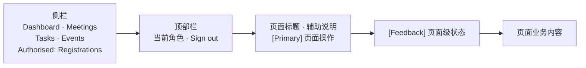

窄屏规则：侧栏收起为顶部菜单；标题和主要操作纵向排列；角色提示与
Sign out 保持可达。敏感导航项只对授权人员显示，但直接访问仍由服务端和
RLS 判断。

## 4. WF-02：登录

- **页面：** PG-02。
- **流程：** FL-01。
- **Issue：** #9–#11。

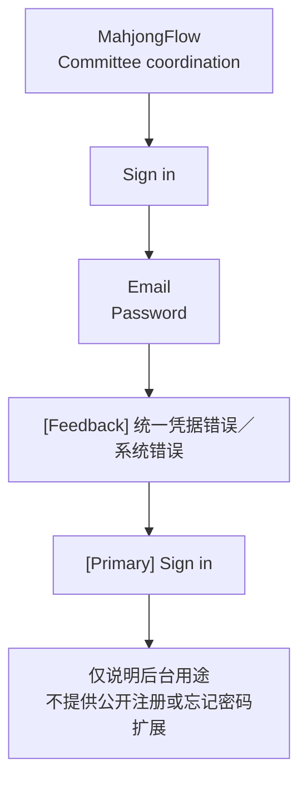

窄屏优先级与桌面一致，表单使用单列。提交期间按钮显示进行中并禁止
重复点击；错误不区分账号不存在或密码错误。

## 5. WF-03：Dashboard

- **页面：** PG-04。
- **流程：** FL-01、FL-04。
- **Issue：** #16、#19、#21、#22。

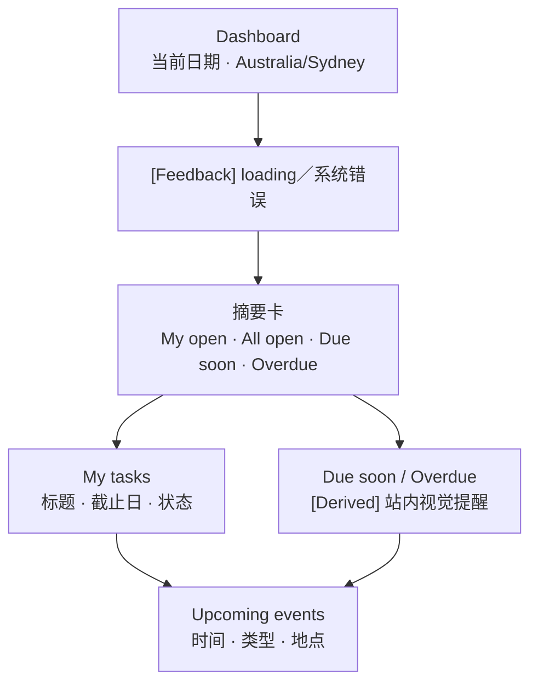

窄屏顺序：标题、逾期／临期摘要、本人任务、全部待办摘要、近期活动。
空状态必须说明“暂无任务”或“暂无近期活动”，不能把加载失败显示成 0。

## 6. WF-04：会议列表

- **页面：** PG-05。
- **流程：** FL-02。
- **Issue：** #12–#14。

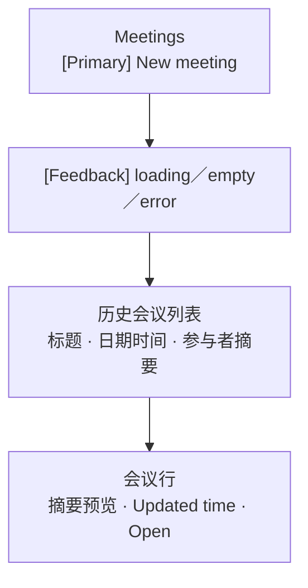

窄屏将表格行改为卡片顺序：标题、日期时间、摘要、打开操作。列表不提供
永久删除；空状态提供 `New meeting` 入口。

## 7. WF-05：会议表单与详情

- **页面：** PG-06、PG-07。
- **流程：** FL-02、FL-03。
- **Issue：** #12–#14、#23、#25。

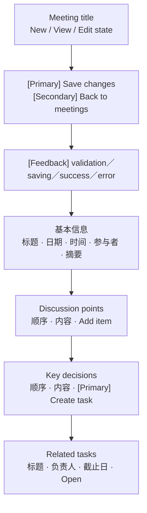

新建页显示空表单；详情页显示已保存内容和关联任务。窄屏先显示会议状态与
保存操作，再显示基本信息、讨论点、决策和关联任务。字段错误贴近字段，
页面顶部同时提供错误摘要。

## 8. WF-06：任务列表

- **页面：** PG-08。
- **流程：** FL-04。
- **Issue：** #15、#16、#20。

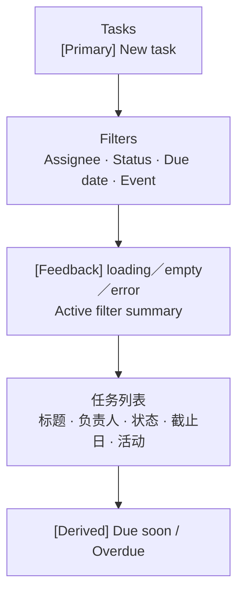

窄屏筛选器收进可展开区域，但当前筛选摘要始终可见。任务卡优先显示标题、
到期状态和负责人，再显示活动。最新筛选结果不得被旧响应覆盖。

## 9. WF-07：任务表单与详情

- **页面：** PG-09、PG-10。
- **流程：** FL-03、FL-04。
- **Issue：** #15、#16、#23–#25。

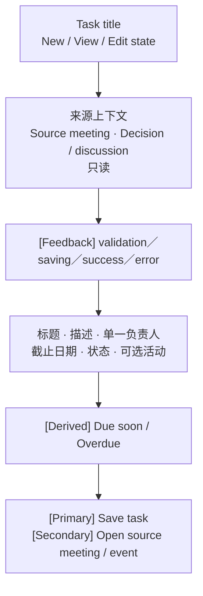

独立任务没有来源区；来源任务始终显示只读来源。窄屏先显示状态与来源，
再显示可编辑字段和保存操作。多个主要负责人不得出现在控件或结果中。

## 10. WF-08：活动列表

- **页面：** PG-11。
- **流程：** FL-05。
- **Issue：** #17、#19。

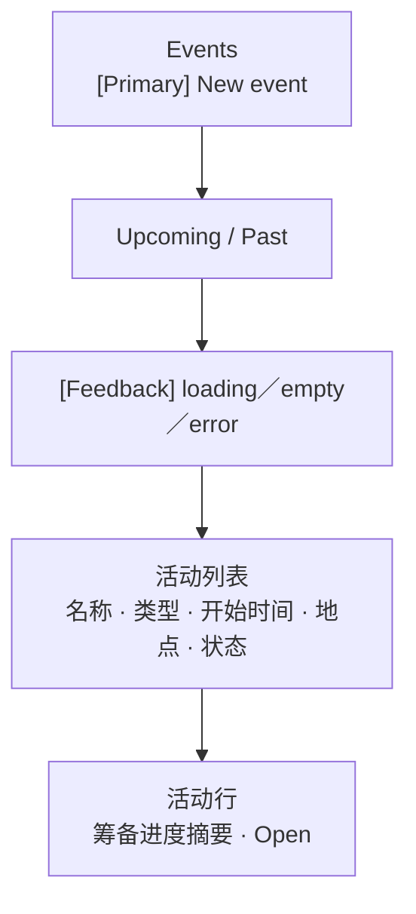

窄屏优先显示名称、开始时间、类型和状态，地点与进度随后显示。默认先展示
即将到来的活动，并按开始时间升序。

## 11. WF-09：活动表单与详情

- **页面：** PG-12、PG-13。
- **流程：** FL-05、FL-06、FL-07。
- **Issue：** #17–#20、#28、#30、#34。

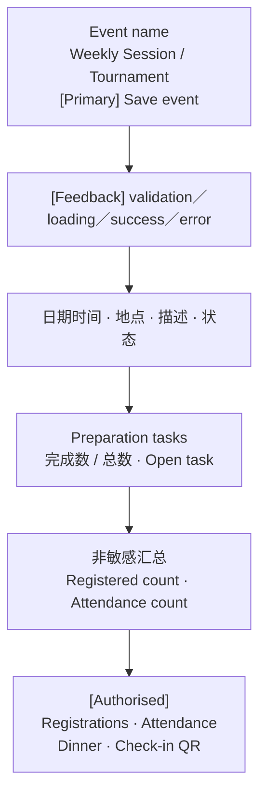

普通委员会成员在线框终止于聚合区，且响应中不得包含个人字段。窄屏将
授权操作放在汇总之后，并以明确的敏感操作分组呈现。

## 12. WF-10：授权报名管理

- **页面：** PG-14。
- **流程：** FL-05。
- **Issue：** #26–#28。

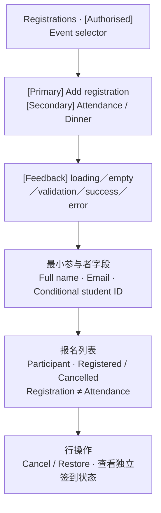

窄屏先选择活动，再显示新增报名操作和表单，最后显示报名卡片。页面不出现
电话、生日、住址、付款资料或紧急联系人字段。普通委员会直接访问时显示
安全权限拒绝，不渲染表单或名单。

## 13. WF-11：参与者 token 签到

- **页面：** PG-03。
- **流程：** FL-06。
- **Issue：** #30、#31。

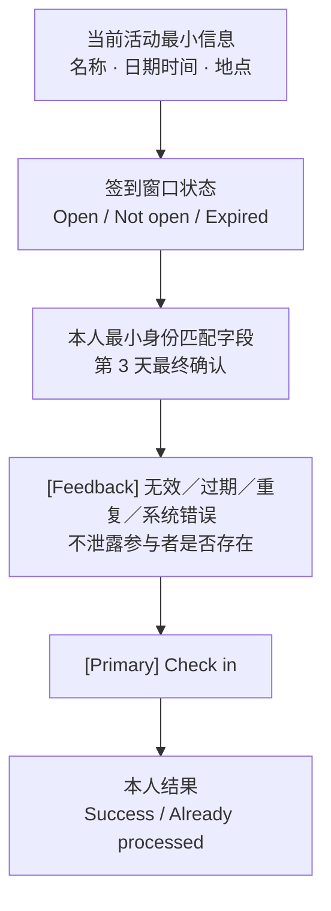

该页面不使用后台壳层，也不显示名单、内部导航、报名明细或晚餐资格。
桌面采用窄内容列；窄屏保持相同顺序并确保主要操作无需横向滚动。

## 14. WF-12：签到明细与人工更正

- **页面：** PG-15。
- **流程：** FL-06、FL-07。
- **Issue：** #32–#34。

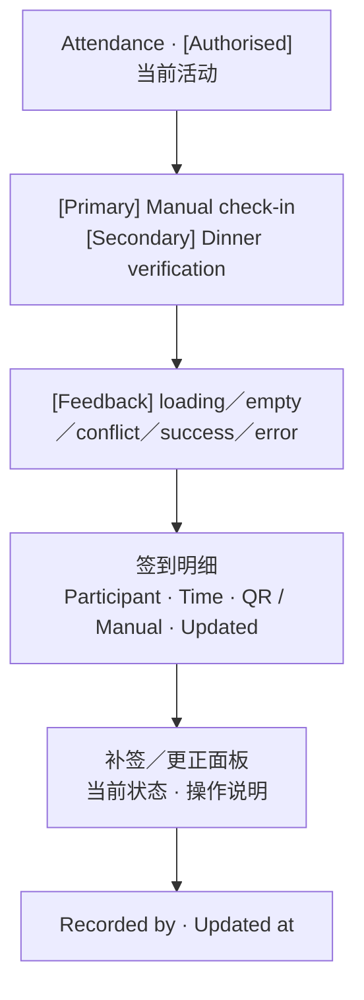

窄屏以参与者卡片替代表格；更正面板在选中记录后显示。普通委员会只能在
活动详情看到聚合数字，不能看到本页面的任何个人字段。

## 15. WF-13：晚餐资格核验

- **页面：** PG-16。
- **流程：** FL-07。
- **Issue：** #35–#37。

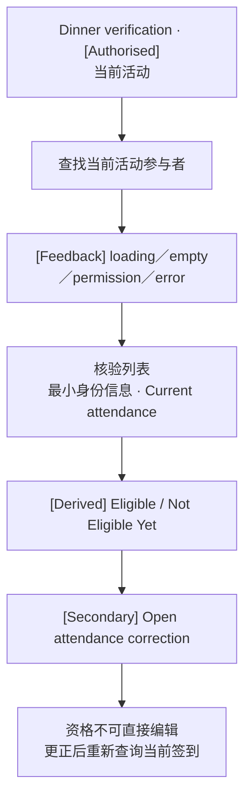

窄屏先显示搜索和当前结果，再显示签到来源与更正入口。资格只从当前确认
签到推导，不显示编辑资格控件，也不收集额外个人属性。

## 16. 页面状态规范

| 状态 | 位置与行为 | 禁止行为 |
|---|---|---|
| Loading | 保留页面骨架；相关操作禁用 | 空白页、无限等待 |
| Empty | 说明为空原因；给出适用操作 | 把加载失败显示为 0 |
| Success | 靠近触发操作；刷新相关数据 | 仅显示瞬时提示而不更新内容 |
| Validation | 字段旁错误；顶部错误摘要 | 清空全部输入 |
| Permission | 安全拒绝；提供返回路径 | 先加载敏感数据再隐藏 |
| Duplicate | 返回幂等或现有记录结果 | 创建第二条报名／签到／来源任务 |
| System error | 安全说明、重试、保留适用输入 | 暴露 SQL、密钥、内部 ID 或个人资料 |

## 17. 桌面与窄屏内容优先级

| 线框 | 桌面重点 | 窄屏最先显示 |
|---|---|---|
| WF-02 | 居中单列登录 | 表单与 Sign in |
| WF-03 | 摘要与任务并列 | 逾期、临期、本人任务 |
| WF-04 | 会议表格 | 标题、日期、Open |
| WF-05 | 会议内容与关联任务 | 状态、保存、基本信息 |
| WF-06 | 筛选器与任务表格 | 筛选摘要、到期状态 |
| WF-07 | 来源与任务字段 | 状态、来源、保存 |
| WF-08 | Upcoming 列表 | 名称、时间、类型 |
| WF-09 | 活动、进度、汇总 | 状态、时间、主要操作 |
| WF-10 | 表单与报名列表 | 活动、新增报名、状态 |
| WF-11 | 窄内容签到卡 | 活动、窗口、Check in |
| WF-12 | 明细表与更正面板 | 参与者、状态、更正 |
| WF-13 | 搜索与核验列表 | 搜索、资格、签到来源 |

窄屏优化仅调整内容顺序和容器，不扩展 P1 的专门移动端签到体验。

## 18. 角色差异

| 区域 | 委员会成员 | 授权人员 | token 参与者 |
|---|---|---|---|
| 后台导航 | Dashboard、Meetings、Tasks、Events | 额外显示 Registrations | 不显示 |
| 活动详情 | 基础资料、任务、聚合数字 | 额外显示敏感操作与 QR | 不进入 |
| 报名／签到／核验 | 拒绝个人明细 | 可查看并操作 | 仅提交本人签到 |
| 系统反馈 | 非敏感协调反馈 | 敏感操作反馈 | 本人最小结果 |

## 19. 线框追踪

| 线框 | 页面 | Flow | Issue |
|---|---|---|---|
| WF-01 | PG-04–16 | FL-01–07 | #9–#37 横切 |
| WF-02 | PG-02 | FL-01 | #9–#11 |
| WF-03 | PG-04 | FL-01、04 | #16、#19、#21、#22 |
| WF-04–05 | PG-05–07 | FL-02、03 | #12–#14、#23、#25 |
| WF-06–07 | PG-08–10 | FL-03、04 | #15、#16、#20、#23–#25 |
| WF-08–09 | PG-11–13 | FL-05–07 | #17–#20、#28、#30、#34 |
| WF-10 | PG-14 | FL-05 | #26–#28 |
| WF-11 | PG-03 | FL-06 | #30、#31 |
| WF-12 | PG-15 | FL-06、07 | #32–#34 |
| WF-13 | PG-16 | FL-07 | #35–#37 |

## 20. 验收结果

- [x] 已覆盖 Dashboard、会议、任务和活动列表／详情；
- [x] 已覆盖登录、报名、签到明细和晚餐核验；
- [x] 每个线框均标明标题、主要操作、内容区和反馈区；
- [x] loading、empty、success、validation、permission 和 error 已定义；
- [x] 普通委员会与授权人员的可见差异已标明；
- [x] 桌面和窄屏的内容顺序与优先级已明确；
- [x] 线框已关联页面、Flow 和 Backlog Issue；
- [x] PG-01 明确为重定向职责，无需伪造独立页面；
- [x] 没有加入 P1 或 Post-MVP 功能。
