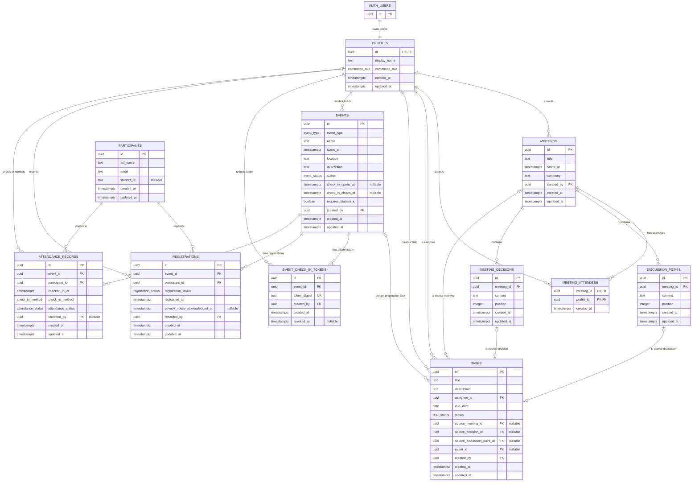
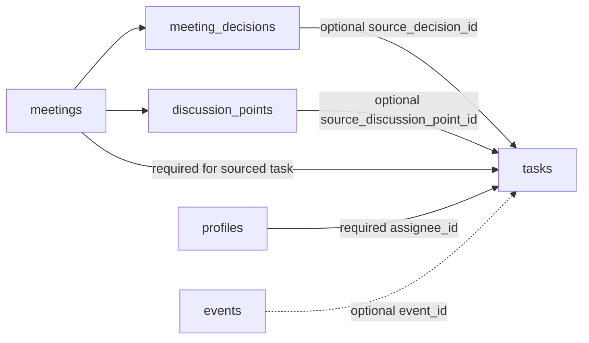
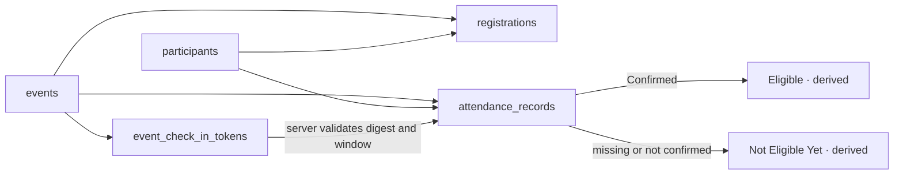

# 第 3 天步骤 3：数据库 ERD 与关系说明

> 所属计划：[第 3 天：数据库、权限与隐私设计](../../DAY_3_DATA_SECURITY_AND_PRIVACY.md)
> 直接输入：[步骤 2：核心实体说明与字段草案](DAY_3_STEP_2_CORE_ENTITIES_AND_FIELDS.md)
> 数据需求：[步骤 1：P0 数据需求及字段候选清单](DAY_3_STEP_1_P0_DATA_REQUIREMENTS.md)
> 验收依据：[第 1 天 P0 用户故事与验收矩阵](../day-1/DAY_1_P0_ACCEPTANCE_MATRIX.md)
> 执行日期：2026-08-04
> 状态：步骤 3 完成；约束、状态与计算规则在步骤 4 固定

## 1. 执行结论

已为步骤 2 的 11 个业务实体确定主键、外键方向、基数、可空关系和预期删除
行为，并将外部认证主体 `auth.users` 作为边界实体加入 ERD。

ERD 可以完整表达以下 P0 链路：

1. 会议 → 决策或讨论点 → 单一来源任务 → 负责人／可选活动；
2. 活动 → 参与者报名；活动 + 参与者 → 独立签到事实 → 派生晚餐资格；
3. 活动 → 可撤销签到 token 摘要 → 受限 QR 签到入口。

没有建立报名到签到的直接外键，也没有建立晚餐资格表。前者确保
`Registered` 不自动等于 `Attended`；后者确保资格只能从当前有效签到事实
计算。

## 2. ERD 图例

| 标记 | 含义 |
|---|---|
| `PK` | 主键 |
| `FK` | 外键 |
| `UK` | 候选唯一键；步骤 4 转换为实际唯一约束 |
| `||` | 必须且恰好一条 |
| `o|` | 零或一条 |
| `o{` | 零或多条 |
| `|{` | 一条或多条 |

图中 `nullable` 表示当前行可以不关联目标实体。审计关系均要求引用有效
`profiles`，但是否允许删除被引用账号由删除策略控制。

## 3. 数据库 ERD 初稿

## 4. 主键设计

| 实体 | 主键 | 选择理由 |
|---|---|---|
| `profiles` | `id` | 与 `auth.users.id` 一对一复用 UUID，避免第二套用户标识 |
| `meetings` | `id` | 稳定引用会议详情和任务来源 |
| `meeting_attendees` | (`meeting_id`, `profile_id`) | 关系本身没有独立业务身份，并天然阻止同一用户重复加入同一会议 |
| `discussion_points` | `id` | 允许任务精确引用讨论点，即使顺序改变仍保持标识 |
| `meeting_decisions` | `id` | 允许任务精确引用决策，即使顺序改变仍保持标识 |
| `tasks` | `id` | 独立任务和来源任务使用统一稳定标识 |
| `events` | `id` | 作为任务、报名、签到和 token 的共同活动上下文 |
| `event_check_in_tokens` | `id` | 支持一个活动保留多个轮换／撤销后的 token 元数据记录 |
| `participants` | `id` | 随机内部 UUID，不向参与者展示 |
| `registrations` | `id` | 便于授权人员更新报名状态；业务唯一性另由活动 + 参与者保证 |
| `attendance_records` | `id` | 便于非破坏性人工更正；业务唯一性另由活动 + 参与者保证 |

步骤 4 必须把 `registrations(event_id, participant_id)` 和
`attendance_records(event_id, participant_id)` 建成唯一约束；它们不使用复合
主键是为了让后台路由、更新和审计引用保持简单。

## 5. 关系与可空性矩阵

### 5.1 认证、会议和任务

| 来源字段 | 目标 | 来源端可空 | 关系与业务含义 |
|---|---|---:|---|
| `profiles.id` | `auth.users.id` | 否 | 一个后台 Auth 用户恰好一个业务资料；没有资料或允许角色时不得进入后台 |
| `meetings.created_by` | `profiles.id` | 否 | 每个会议恰好一个创建者；一个用户可创建多个会议 |
| `meeting_attendees.meeting_id` | `meetings.id` | 否 | 每条参与关系属于一个会议；业务要求会议至少一名参与者 |
| `meeting_attendees.profile_id` | `profiles.id` | 否 | 每条参与关系指向一个后台用户 |
| `discussion_points.meeting_id` | `meetings.id` | 否 | 一个讨论点只能属于一个会议；会议可没有或有多个讨论点 |
| `meeting_decisions.meeting_id` | `meetings.id` | 否 | 一个决策只能属于一个会议；会议可没有或有多个决策 |
| `tasks.assignee_id` | `profiles.id` | 否 | 每个任务恰好一个主要负责人 |
| `tasks.created_by` | `profiles.id` | 否 | 每个任务恰好一个创建者 |
| `tasks.source_meeting_id` | `meetings.id` | 是 | 独立任务为空；任何讨论点／决策来源任务必须有会议来源 |
| `tasks.source_decision_id` | `meeting_decisions.id` | 是 | 只有决策来源任务填写；每个任务至多一个来源决策 |
| `tasks.source_discussion_point_id` | `discussion_points.id` | 是 | 只有讨论点来源任务填写；每个任务至多一个来源讨论点 |
| `tasks.event_id` | `events.id` | 是 | 一个任务最多关联一个活动；活动可关联多个任务 |

`source_decision_id` 和 `source_discussion_point_id` 不能同时有值，且具体来源的
`meeting_id` 必须等于任务的 `source_meeting_id`。这是步骤 4 必须落实的跨字段／
跨表一致性规则。为满足重复转换不创建第二条任务的 P0 验收，一个决策或
讨论点最多对应一条来源任务；步骤 4 通过部分唯一索引落实。

### 5.2 活动、报名、签到和 token

| 来源字段 | 目标 | 来源端可空 | 关系与业务含义 |
|---|---|---:|---|
| `events.created_by` | `profiles.id` | 否 | 每个活动恰好一个创建者 |
| `event_check_in_tokens.event_id` | `events.id` | 否 | 每个 token 摘要只属于一个活动；活动可保留多个历史 token |
| `event_check_in_tokens.created_by` | `profiles.id` | 否 | 每次生成入口均有授权后台用户负责 |
| `registrations.event_id` | `events.id` | 否 | 每条报名属于一个活动 |
| `registrations.participant_id` | `participants.id` | 否 | 每条报名属于一个参与者 |
| `registrations.recorded_by` | `profiles.id` | 否 | P0 报名均由一个授权用户代录 |
| `attendance_records.event_id` | `events.id` | 否 | 每条签到属于一个活动 |
| `attendance_records.participant_id` | `participants.id` | 否 | 每条签到属于一个参与者 |
| `attendance_records.recorded_by` | `profiles.id` | 是／条件 | 未经人工处理的 QR 签到为空；人工补签或更正后必须有授权用户 |

`registrations` 与 `attendance_records` 不互相引用。二者通过相同的
`event_id + participant_id` 业务键并行关联活动与参与者，因此报名不会自动
创建签到，签到更正也不会改变报名状态。是否要求有效报名才能 QR 签到属于
步骤 4 的服务端业务规则，不通过外键隐式决定。

## 6. 外键删除与归档预期

### 6.1 总体原则

- P0 业务页面不提供会议、活动、参与者、报名、签到或任务的永久删除；
- 关键历史、来源、责任或个人参与关系默认使用 `RESTRICT`／`NO ACTION`，
  不用 `SET NULL` 静默抹去上下文；
- 只有完全依附父记录、没有独立生命周期的子项可在受控父记录删除时
  `CASCADE`；
- 测试数据按活动清理必须显式选择目标活动的虚构报名和签到，不依赖删除
  活动触发大范围级联；
- 当前 schema 不增加 `archived_at`。如果以后按已批准变更加入归档，归档只
  改变列表可见性，不删除或断开关系，来源链接仍应可追溯。

### 6.2 外键行为矩阵

| 外键 | 预期 `ON DELETE` | 理由／受控处理 |
|---|---|---|
| `profiles.id` → `auth.users.id` | `RESTRICT` | 防止删除 Auth 用户后留下无法解释的负责人和审计引用；先走账号停用或受控重分配 |
| `meetings.created_by` → `profiles.id` | `RESTRICT` | 保留会议创建责任 |
| `meeting_attendees.meeting_id` → `meetings.id` | `CASCADE` | 参与关系完全依附会议；仅受控维护删除会议时清理 |
| `meeting_attendees.profile_id` → `profiles.id` | `RESTRICT` | 不静默改写历史参会人 |
| `discussion_points.meeting_id` → `meetings.id` | `CASCADE` | 讨论点没有脱离会议的独立含义；有来源任务时任务外键会先阻止删除 |
| `meeting_decisions.meeting_id` → `meetings.id` | `CASCADE` | 决策没有脱离会议的独立含义；有来源任务时任务外键会先阻止删除 |
| `tasks.assignee_id` → `profiles.id` | `RESTRICT` | 任务必须保留负责人；删除账号前先受控重分配 |
| `tasks.created_by` → `profiles.id` | `RESTRICT` | 保留任务创建责任 |
| `tasks.source_meeting_id` → `meetings.id` | `RESTRICT` | 不允许删除会议后静默丢失任务来源 |
| `tasks.source_decision_id` → `meeting_decisions.id` | `RESTRICT` | 不允许删除已产生任务的决策 |
| `tasks.source_discussion_point_id` → `discussion_points.id` | `RESTRICT` | 不允许删除已产生任务的讨论点 |
| `tasks.event_id` → `events.id` | `RESTRICT` | 不通过删除活动静默解除筹备任务关系 |
| `events.created_by` → `profiles.id` | `RESTRICT` | 保留活动创建责任 |
| `event_check_in_tokens.event_id` → `events.id` | `CASCADE` | token 只在活动上下文中有意义；活动删除本身仍会被任务／报名／签到关系阻止 |
| `event_check_in_tokens.created_by` → `profiles.id` | `RESTRICT` | 保留 token 生成责任 |
| `registrations.event_id` → `events.id` | `RESTRICT` | 防止删除活动时意外删除敏感报名事实；测试清理由明确维护流程处理 |
| `registrations.participant_id` → `participants.id` | `RESTRICT` | 防止存在报名时删除参与者主记录 |
| `registrations.recorded_by` → `profiles.id` | `RESTRICT` | 保留授权代录责任 |
| `attendance_records.event_id` → `events.id` | `RESTRICT` | 防止删除活动时意外删除签到和资格依据 |
| `attendance_records.participant_id` → `participants.id` | `RESTRICT` | 防止存在签到时删除参与者主记录 |
| `attendance_records.recorded_by` → `profiles.id` | `RESTRICT` | 保留人工补签／更正责任；空值仅表示未经人工处理的 QR 签到 |

### 6.3 删除路径检查

- 删除有来源任务的会议会先被 `tasks.source_meeting_id`、具体来源外键阻止，
  因而不会先级联删除决策／讨论点造成来源悬空；
- 删除有任务、报名或签到的活动会被 `RESTRICT` 阻止；token 的 `CASCADE` 只在
  活动已经没有这些阻塞关系且由受控维护删除时生效；
- 删除参与者会被报名或签到阻止；数据保留期限确认后的清理必须按批准顺序
  显式处理子记录和主记录；
- 删除后台用户会被负责人、创建者、代录人和更正者关系阻止。P0 不通过
  `SET NULL` 抹掉责任人。

## 7. 两条核心业务链路验证

### 7.1 会议决策／讨论点转任务

链路解释：

1. 会议先以 `meetings.id` 建立稳定上下文；
2. 决策或讨论点分别以自身 UUID 保留精确来源，并通过 `meeting_id` 归属会议；
3. 转换任务保存 `source_meeting_id`，并只保存一个具体来源外键；
4. `assignee_id` 和 `due_date` 必填，保证任务可以跟进；
5. 任务可选关联活动，但活动关系不影响来源关系；
6. 会议页通过来源外键反查任务，任务页通过来源外键返回会议；
7. 决策“已转任务”从反向查询派生，不存在第二个可漂移状态。

因此 ERD 可表达 US-02 的决策来源、讨论点来源、单一负责人、双向导航和可选
活动关系。

### 7.2 活动报名、签到与晚餐核验

链路解释：

1. `participants` 只保存姓名、邮箱和条件性学号；
2. `registrations` 以活动 + 参与者保存报名状态，报名不创建签到；
3. `event_check_in_tokens` 将摘要绑定活动；服务端同时验证 token、活动窗口和
   参与者，不能只依赖页面已打开；
4. `attendance_records` 以同一活动 + 参与者保存独立、唯一的签到事实；
5. QR 签到可没有 `recorded_by`，人工补签或更正必须引用授权用户；
6. 当前确认有效的签到派生 `Eligible`；没有有效签到派生
   `Not Eligible Yet`；
7. 人工更正只改变唯一签到事实，资格在下一次查询时同步变化，不写资格表。

因此 ERD 同时支持报名人数、签到人数、重复防护、人工更正和晚餐资格推导，
且普通委员会所需聚合不要求读取个人字段。

## 8. 循环依赖与不可表达流程检查

| 检查项 | 结论 | 说明 |
|---|---|---|
| Auth 与 profile | 无数据库环 | 单向 `profiles.id` 引用外部 `auth.users.id` |
| 会议与任务 | 无环 | 只有任务引用会议／子项；会议“关联任务”通过反向查询派生 |
| 活动与任务 | 无环 | 只有 `tasks.event_id` 引用活动；活动进度通过反向聚合派生 |
| 决策转任务状态 | 无环 | 决策不反向保存 task ID 或布尔状态 |
| 报名与签到 | 无环 | 两个事实并行引用活动和参与者，不互相引用 |
| 签到与资格 | 无环 | 资格不落库，只读签到状态 |
| token 与活动 | 无环 | token 引用活动；活动不保存 token ID |
| 审计用户引用 | 无环 | 业务记录引用 profile，profile 不反向保存业务记录 |

未发现无法表达的 P0 流程。唯一需要步骤 4 额外保证的是跨表条件一致性，而
不是缺少实体或关系：

- 具体任务来源必须属于 `source_meeting_id`；
- 来源决策与来源讨论点互斥；
- 签到 token、窗口、活动和参与者必须在同一次可信服务端操作中验证；
- 条件性学号和 `recorded_by` 必须按业务路径验证；
- 同活动同参与者的报名和签到必须分别唯一。

## 9. 步骤 4 的约束输入

| 类别 | 从 ERD 得出的待实施规则 |
|---|---|
| 主键 | 10 个 UUID 单列主键；`meeting_attendees` 使用复合主键 |
| 关系唯一性 | 会议参与者、报名、签到分别需要复合唯一性；token 摘要必须唯一 |
| 来源一致性 | 来源任务必须有会议；决策／讨论点互斥且属于同一会议 |
| 可选关系 | 独立任务来源为空；任务活动可空；QR `recorded_by` 可空；活动窗口可整体为空 |
| 状态 | 固定任务、活动、报名、签到方式和签到有效状态的允许值 |
| 派生 | 逾期、临期、进度、报名数、签到数、转任务状态和资格均不落库 |
| token | 摘要、唯一有效 token、撤销、窗口和重复提交需数据库与服务端协同 |
| 删除 | 迁移按本文件的 `RESTRICT`／`CASCADE` 矩阵显式声明，不依赖默认行为 |

## 10. 步骤 3 完成检查

- [x] 已为 11 个业务实体及外部 Auth 边界确定主键；
- [x] 已连接会议、参与者、讨论点和关键决策关系；
- [x] 已连接任务负责人、创建者、会议来源、具体来源和可选活动；
- [x] 已连接活动、参与者、报名、签到和 token；
- [x] 已逐项标注外键删除行为及归档预期；
- [x] 已标明所有必需与可空关系；
- [x] 已确认报名和签到保持独立，晚餐资格保持派生；
- [x] 已检查循环依赖，未发现无法表达的 P0 流程；
- [x] 已沿 ERD 完整解释“会议决策／讨论点转任务”链路；
- [x] 已沿 ERD 完整解释“活动报名到签到与晚餐核验”链路；
- [x] ERD 没有加入 P1 或 Post-MVP 实体。
